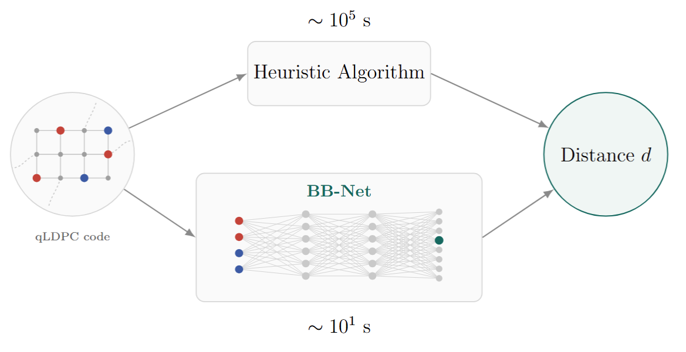
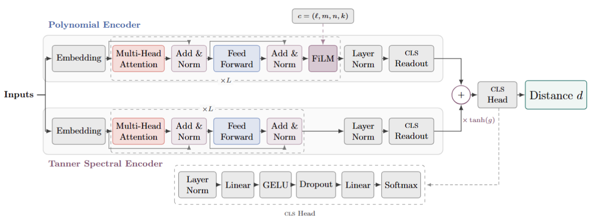

# Distance Prediction for Quantum Codes
[](https://arxiv.org/pdf/2610.18130)

<a href="https://nadavsc.github.io/">Nadav Schneider</a>,
<a href="https://sites.google.com/view/eliya-nachmani/home">Eliya Nachmani</a>
     
This repository contains the official PyTorch implementation of BBNet model. We also provide the pre-process code, and inference.

## News
- [2025.10.13] We have uploaded our paper to [arXiv](https://arxiv.org/pdf/2610.18130).

<p align="center">
 
</p>

## Setup
## Clone Project
```
git clone https://github.com/nadavsc/BBNet.git
cd BBNet
```

## Create Environment
To set up our environment, please run:
```
conda create -n bbnet python=3.9
pip install -r requirements.txt
```
Note: this should include all the necessary packages to run all the training and evaluation scripts. Nonetheless, make sure the additional requirements are satisfied:

## Requirements

- Python 3.9+
- PyTorch (a version whose `torch.load` accepts `weights_only`)
- NumPy

```bash
pip install -r requirements.txt
```

<p align="center">

</p>

## Quick start

Run the three built-in example codes with trained weights:

```bash
python modeling_bbnet.py --depth 8 --width 256 --checkpoint out/bbnet.pt
```

Expected output with correctly loaded weights:

```
BB-Net  depth=8  width=256  parameters=...  weights=bbnet_12M.pt
     [[72,12,6]]  predicted d = 6
     [[90,8,10]]  predicted d = 10
   [[144,12,12]]  predicted d = 12
```

The examples are the [[72,12,6]], [[90,8,10]] and [[144,12,12]] (gross) codes from
Bravyi et al. (2024), whose distances are known.

Print the full module tree as well:

```bash
python modeling_bbnet.py --checkpoint out/bbnet.pt --verbose 1
```

Without `--checkpoint` the model runs with random weights. The predictions are then
meaningless, but the run confirms that featurisation and the forward pass work.

### Command-line options

| Option | Default | Meaning |
|---|---|---|
| `--depth` | `8` | Number of transformer blocks per encoder (L) |
| `--width` | `256` | Model width (d_model); must be divisible by 8 |
| `--checkpoint` | none | Weights saved by the original training code |
| `--verbose` | `0` | `1` or higher prints the model architecture |

`--depth` and `--width` must match the checkpoint. The reported model uses L = 8, d_model = 256.

## Predicting your own codes

```python
import torch
from modeling_bbnet import BBNet, BBCode, featurise, collate, convert_state_dict

model = BBNet(depth=8, width=256)
ckpt = torch.load("bbnet.pt", map_location="cpu", weights_only=False)
model.load_state_dict(convert_state_dict(ckpt.get("state_dict", ckpt)))
model.eval()

# Gross code: l=12, m=6, k=12, A = x^3 + y + y^2, B = y^3 + x + x^2
codes = [
    BBCode(12, 6, 12, A=[(3, 0), (0, 1), (0, 2)], B=[(0, 3), (1, 0), (2, 0)]),
]
distances = model.predict(collate([featurise(c) for c in codes]))
print(distances.tolist())   # [12]
```

### Code specification

`BBCode(ell, m, k, A, B, C=(), D=())`

- `ell`, `m`: the group Z_ℓ × Z_m. Block length is n = 2ℓm.
- `k`: number of logical qubits. It conditions the model, so it must be the code's
  true logical dimension (compute it beforehand).
- `A`, `B` (and `C`, `D` for PBB codes): each polynomial is given by its support, a
  list of exponent pairs `(a, b)` with `0 <= a < ell`, `0 <= b < m`, one per monomial
  x^a y^b. For example, `A = x^3 + y + y^2` is `[(3, 0), (0, 1), (0, 2)]`.
- A code with `C` and `D` empty is treated as a CSS BB code; otherwise it is a
  non-CSS PBB code.

### Valid input range

The model was trained on codes with n ≤ 360, ℓ, m ≤ 30, and distances 2–25.
Predictions are always one of 2, …, 25.


## Citation
If you use this code, please consider citing the following:

```bibtex
@misc{schneider2026distancepredictionquantumcodes,
      title={Distance Prediction for Quantum Codes}, 
      author={Nadav Schneider and Eliya Nachmani},
      year={2026},
      eprint={2610.18130},
      archivePrefix={arXiv},
      primaryClass={quant-ph},
      url={https://arxiv.org/abs/2610.18130}, 
}
```
